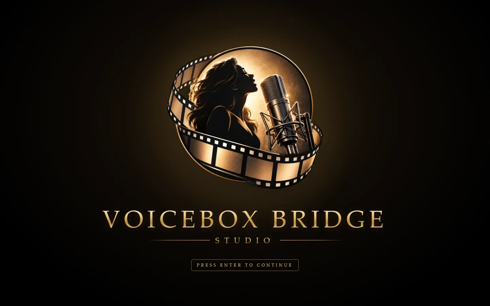
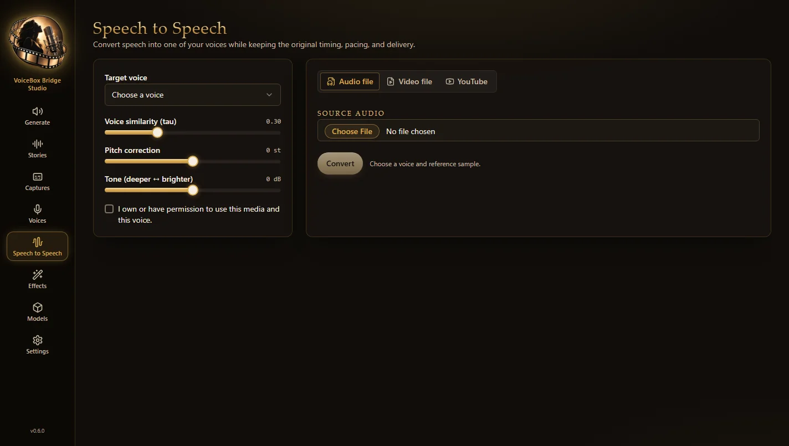
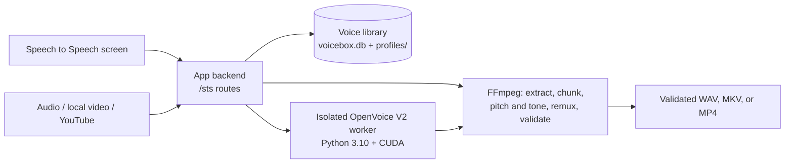

# VoiceBox Bridge Studio



A fully local voice studio for Windows. Clone voices, generate speech, and
convert existing recordings and videos into any of your voices, all on your
own machine, with no cloud inference, subscription, or per-minute cost.

VoiceBox Bridge Studio is created and maintained by
**[DigitalGods](https://github.com/Digitalgods2)**. It is built on
[VoiceBox](https://github.com/jamiepine/voicebox) by Jamie Pine and contributors
(MIT): it keeps VoiceBox's text-to-speech, voice cloning, stories, captures,
effects, and model management, and adds **speech-to-speech** as a built-in
feature: the **Speech to Speech** screen. See [NOTICE.md](NOTICE.md) for credits and licenses.

> [!IMPORTANT]
> Use only voices and source media that you own or have permission to process.
> Every speech-to-speech job requires an explicit rights confirmation. This app
> does not bypass DRM, account restrictions, or access controls.

## Contents

- [What's inside](#whats-inside)
- [Requirements](#requirements)
- [Installation](#installation)
- [Running the app](#running-the-app)
- [Using Speech to Speech](#using-speech-to-speech)
- [Your data](#your-data)
- [Configuration](#configuration)
- [HTTP API](#http-api)
- [Troubleshooting](#troubleshooting)
- [Customizing the look](#customizing-the-look)
- [Development](#development)
- [Credits and license](#credits-and-license)

## What's inside

The app opens to a full-window title card (press **Enter** or click to
continue), then to a studio with one consistent look: gold on black-brown,
gold serif titles, and text and prompts tuned for easy reading.

| Screen | What it does |
| --- | --- |
| **Generate** | Your voices as cards, a prompt box for text-to-speech, and your generation history. Choose a voice, language, model, and effects, then generate. |
| **Stories** | Arrange generations on a multi-track timeline to build longer pieces, with trimming, volume, and export. |
| **Captures** | Dictation: hold a global shortcut, speak, and get a local Whisper transcript, optionally refined by a local LLM; replay it in any voice. |
| **Voices** | Create and edit voice profiles: clone from an audio sample or recording, pick a built-in voice, or describe one; manage samples and default effects. |
| **Speech to Speech** | Convert an audio file, a video from your PC, or an authorized YouTube video into one of your cloned voices, keeping the original timing, pacing, emphasis, and emotion. |
| **Effects** | Build effect presets (pitch, filters, reverb, delay, compression, and more) to apply to generations. |
| **Models** | Download and manage the local models: TTS engines, Whisper for transcription, and the refinement LLM. Most are 1–5 GB; downloads run in the background with progress. |
| **Settings** | General, Generation, Captures, MCP (connect AI coding agents), Changelog, and About. |

TTS engines available from the Models screen: Qwen3-TTS (0.6B and 1.7B),
Qwen CustomVoice and VoiceDesign, LuxTTS, Chatterbox (multilingual and Turbo),
HumeAI TADA, Kokoro, and OmniVoice. Check each model's license before use;
OmniVoice's weights, for example, are non-commercial.



### How Speech to Speech works

A voice profile is a set of reference recordings with transcripts, not a
trained per-speaker model. Speech to Speech takes the selected profile's
reference sample straight from the app's own voice library, extracts a speaker
embedding with [OpenVoice V2](https://github.com/myshell-ai/OpenVoice), and
converts the original performance directly. It never transcribes to text and
re-synthesizes, which would lose timing and delivery.



Quality and timing guarantees:

- Long videos are converted in 256-sample-aligned, overlapping chunks with one
  model load, crossfaded, and rebuilt to the **exact** source frame count.
- The picture is copied without re-encoding. MKV output carries lossless FLAC
  audio; MP4 carries AAC for wider player support.
- Pitch correction is formant-preserving (Rubber Band) and never changes speed.
- Every output is fully decoded before a job is reported complete.
- OpenVoice V2 converts at 22.05 kHz mono. Music and effects in a video's
  soundtrack reach the model too, so dialogue-forward sources work best.

## Requirements

- Windows 10 or 11. VoiceBox's code also supports macOS and Linux; the Voice
  Changer has been validated on Windows.
- An NVIDIA GPU is recommended; CPU works, much more slowly.
- [Python 3.12](https://www.python.org/), [Bun](https://bun.sh),
  [just](https://github.com/casey/just), and Git
- FFmpeg and FFprobe on `PATH` (with Rubber Band, for pitch correction)
- Node.js 22 or newer (used by yt-dlp for YouTube)
- Miniconda or another Conda (for the isolated Speech to Speech engine)
- For the optional installable desktop app only: [Rust](https://rustup.rs) and
  the [Tauri prerequisites](https://v2.tauri.app/start/prerequisites/)

## Installation

All commands run in PowerShell from the project folder.

1. **Get the code**

   ```powershell
   git clone https://github.com/Digitalgods2/Voicebox-STS-Sidecar.git
   cd Voicebox-STS-Sidecar
   ```

2. **Backend environment**: PyTorch with CUDA and the TTS engine packages,
   a multi-gigabyte download (roughly 3.5–4 GB, about 7 GB on disk). No model
   weights are downloaded in this step.

   ```powershell
   just setup-python
   ```

3. **Web UI dependencies**: `bun install`. The launcher builds the UI on first
   run, or build it yourself with `bun run build:web`.

4. **Speech to Speech engine**: an isolated OpenVoice V2 runtime (about 2.5 GB
   with CUDA PyTorch, plus a 131 MB, MIT-licensed converter checkpoint that is
   hash-verified). Follow [docs/sts/engine-install.md](docs/sts/engine-install.md).

5. **Bring over an existing VoiceBox library** (optional). If you used the
   standalone VoiceBox app, copy its voices, samples, history, and captures
   into this app. The original library is only read, never changed:

   ```powershell
   backend\venv\Scripts\python scripts\import_voicebox_data.py --dry-run
   backend\venv\Scripts\python scripts\import_voicebox_data.py
   ```

   Voices that have a pitch effect start Speech to Speech at that pitch.

6. **Download a TTS model** from the **Models** screen, for example
   Qwen TTS 0.6B (about 2.3 GB). Models already in your Hugging Face cache are
   reused.

7. **Build the launcher** once: `launcher\build.bat` creates
   `VoiceBoxBridgeStudio.exe` in the project folder.

## Running the app

Double-click **`VoiceBoxBridgeStudio.exe`** in the project folder. It:

- starts the app on `http://127.0.0.1:17493` (loopback only) using this
  folder's `data\` workspace, and opens your browser to the title card;
- shows a tray icon with **Open VoiceBox Bridge Studio**, **View Logs**, and
  **Quit**. There's no console window, and **Quit** stops everything;
- offers to close the separately installed VoiceBox app if it's holding the
  port (this app does everything VoiceBox did);
- tells you what's missing if setup isn't finished, instead of failing silently.

[`start-app.bat`](start-app.bat) does the same in a console window. Logs are
written to `data\logs\app.log`.

For development with hot reload:

```powershell
just dev           # backend + desktop app
bun run dev:web    # browser UI against a running backend
just --list        # every available command
```

## Using Speech to Speech

1. **Choose a target voice.** Only cloned voices with reference samples can be
   used. If the voice has one sample it's selected automatically; otherwise
   choose one. Play the reference to check it. A clean 15–30 second,
   single-speaker sample works best.
2. **Adjust if needed.** Settings are remembered for each voice.
   - **Voice similarity (tau)**: the OpenVoice conversion parameter, 0–1
     (default 0.30).
   - **Pitch correction**: −6 to +6 semitones without changing speed. Not
     note-by-note tuning.
   - **Tone**: −6 dB (deeper) to +6 dB (brighter), a 2.5 kHz high shelf.
   Start with small changes, such as 0.5–2 semitones or 1–3 dB.
3. **Confirm** you own or have permission to use the media and the voice.
4. **Pick a source** in one of three tabs:
   - **Audio file**: WAV, MP3, FLAC, M4A, AAC, OGG, OPUS, or WMA, up to 1 GiB.
     The result is a validated WAV you can play and download.
   - **Video file**: AVI, M2TS, M4V, MKV, MOV, MP4, MPEG, MPG, TS, WebM, or
     WMV, up to 12 GiB, with both video and audio streams.
   - **YouTube**: one authorized video's HTTPS link (watch, Shorts, live,
     embed, or youtu.be). Playlists, channels, and search pages are rejected.
     The last downloaded video is kept, so converting it again with another
     voice needs no new download. You can save or clear that cached source.

   For video, choose **MKV** (lossless FLAC audio) or **MP4** (AAC audio).
5. **Convert** and watch the stages: download, extraction, chunk conversion,
   timeline reconstruction, pitch and tone, remux, and validation. Then play
   or download the result.
6. **Tidy up** whenever you like:
   - **Clear** (next to the source) removes the uploaded file from the app's
     storage and empties the picker; for YouTube it clears the link. Choosing
     a new file also removes the one it replaces.
   - **Delete** (next to a result, after a confirmation) removes the converted
     file and its job record. It can't be undone. Download the result first if
     you want to keep it. Your source and voices aren't affected.

   Both are unavailable while a conversion is running.

Keep the app running until a job finishes. Jobs don't resume after the app
is closed; submit an interrupted job again.

## Your data

Everything stays in the project's `data\` folder, which git ignores:

| Path | Contents |
| --- | --- |
| `voicebox.db`, `profiles\` | Your voice library (voices, samples, avatars) |
| `generations\`, `captures\` | Generated speech and dictation recordings |
| `inputs\`, `outputs\`, `audio_jobs\`, `jobs\` | Speech to Speech audio uploads, results, and job records |
| `video_inputs\`, `video_jobs\`, `youtube_cache\` | Speech to Speech video uploads, jobs, and the cached YouTube source |
| `models\openvoice-v2\` | The Speech to Speech converter checkpoint |
| `backups\` | Safety copies, such as an imported VoiceBox library |
| `logs\app.log` | Launcher and server log |

TTS model weights live in the shared Hugging Face cache (usually
`%USERPROFILE%\.cache\huggingface\hub`). Completed video jobs are kept for 30
days and failed ones for 24 hours; startup cleanup only touches Speech to Speech
job folders. To back up your voices, copy `data\voicebox.db` and
`data\profiles\` together, or export individual voices from the Voices screen.

Everything runs locally. The server listens only on `127.0.0.1`, and the
Speech to Speech engine runs with Hugging Face offline mode forced on. The only
network access is what you start: model downloads, YouTube downloads, and the
optional VoiceBox Cloud sync (off unless `VOICEBOX_CLOUD_ENABLED` is set).
See [SECURITY.md](SECURITY.md).

## Configuration

| Variable | Purpose |
| --- | --- |
| `APP_PORT` | Port for the launcher and `start-app.bat` (default 17493) |
| `STS_ENGINE_DEVICE` | Speech to Speech device: `cuda:0` (default), `cuda`, `cuda:<index>`, or `cpu` |
| `STS_ENGINE_ROOT` | Folder holding `.envs\`, `third_party\`, and `data\models\` for the engine, if not the project folder |
| `STS_VIDEO_JOB_RETENTION_DAYS` | Completed video job retention (default 30) |
| `STS_FAILED_VIDEO_JOB_RETENTION_HOURS` | Failed video job retention (default 24) |
| `STS_ORPHAN_VIDEO_INPUT_RETENTION_HOURS` | Unused video upload retention (default 24) |
| `VOICEBOX_MODELS_DIR` | Custom Hugging Face cache folder for TTS models |

The older `BRIDGE_*` names for the `STS_*` variables are still accepted.

## HTTP API

The app has a local, unauthenticated HTTP API on `http://127.0.0.1:17493`;
interactive documentation is at `/docs` while it runs.

- **Text-to-speech, voices, history, effects, captures, models**: the VoiceBox
  API (`/generate`, `/profiles`, `/history`, …); also listed in
  Settings → General → API Access.
- **Speech to Speech**: everything under `/sts`. See
  [docs/sts/api.md](docs/sts/api.md) and the standard-library Python client in
  [examples/speech_client.py](examples/speech_client.py):

  ```powershell
  python examples/speech_client.py
  python examples/speech_client.py --input speech.wav --voice PROFILE_UUID --authorized --output converted.wav
  ```

- **AI coding agents** (Claude Code, Cursor, and others) can use the local MCP
  server at `/mcp`; Settings → MCP has ready-to-paste configuration.

Keep the API on loopback. Don't expose it to a network without adding
authentication.

## Troubleshooting

| Problem | What to do |
| --- | --- |
| "The backend environment is not finished installing" | If `just setup-python` is still running, wait for it. Otherwise run it again; the message names the missing package. |
| "Port 17493 is in use" | Close the separately installed VoiceBox app (the launcher offers to), or set `APP_PORT`. |
| The browser shows JSON instead of the app | Rebuild the UI with `bun run build:web`, then reload. |
| Speech to Speech says the engine isn't ready | Finish [docs/sts/engine-install.md](docs/sts/engine-install.md), then run `backend\venv\Scripts\python -m backend.sts engine-status`. |
| No GPU, or CUDA errors | Set `STS_ENGINE_DEVICE=cpu` for Speech to Speech; TTS engines fall back to CPU automatically. |
| A voice is greyed out in Speech to Speech | It has no reference samples (preset and designed voices). Use a cloned voice. |
| Pitch or tone adjustments fail | Your FFmpeg build needs the `rubberband` filter. |
| YouTube download fails | Check that the link is a single public or authorized video, Node.js 22+ is installed, and yt-dlp is current: `backend\venv\Scripts\python -m pip install -U "yt-dlp<2027"`. |
| Text-to-speech says no model | Download one from the Models screen. |
| Something else | Tray icon → **View Logs**, or open `data\logs\app.log`. |

## Customizing the look

- **Logo**: replace `branding/logo-source.png`, then run
  `backend\venv\Scripts\python scripts\make_app_icon.py`,
  `cd tauri; bunx tauri icon app-icon.png`, and `launcher\build.bat`. The script
  removes the artwork's white background and writes the in-app logo,
  favicons, and desktop icons.
- **Theme**: there is one studio theme. Its colors are the `:root, .dark` tokens
  in `app/src/index.css`, with shared styles for gold serif titles
  (`.brand-title`), section labels (`.brand-label`), and primary buttons
  (`.gold-fill`). Keep text contrast at 4.5:1 or better.
- **Title card**: `app/src/components/LaunchScreen/`. It appears once per
  browser tab, so a page refresh skips it.

## Development

| Path | What's there |
| --- | --- |
| `backend/` | FastAPI backend (from VoiceBox): TTS engines, profiles, history, effects, captures, MCP server |
| `backend/sts/` | Speech to Speech: workspace voices, OpenVoice client and worker, audio and video pipelines |
| `backend/routes/sts.py` | The `/sts` HTTP endpoints |
| `app/` | Shared React UI (Speech to Speech: `app/src/components/VoiceChangerTab/`) |
| `web/`, `tauri/` | Browser build and the desktop app shell |
| `launcher/` | Source and build script for `VoiceBoxBridgeStudio.exe` |
| `scripts/` | Icon, data import, and upstream build scripts |
| `branding/` | Original logo artwork |
| `config/` | OpenVoice provenance, hashes, and audited requirements |
| `docs/sts/` | Speech to Speech API, engine install, audit, and validation records |

Tests and checks:

```powershell
backend\venv\Scripts\python -m pytest backend\tests\sts    # Speech to Speech (no GPU or ML stack needed)
backend\venv\Scripts\python -m pytest backend\tests        # full backend suite
bun run typecheck
bun run build:web
```

CI runs the typecheck, the web build, and Speech to Speech tests on every
push to `main`. When changing upstream VoiceBox files, change only what you
need; they aren't auto-formatted, and reformatting them makes upstream updates
harder to merge.

**Updates and releases**: auto-update is turned off, because the update feed
and signing key belonged to upstream VoiceBox. [SECURITY.md](SECURITY.md)
explains how to set up your own.

Project records: [AGENTS.md](AGENTS.md) (architecture and decisions),
[docs/sts/engine-audit.md](docs/sts/engine-audit.md),
[docs/sts/validation.md](docs/sts/validation.md), and
[CHANGELOG.md](CHANGELOG.md) (upstream VoiceBox history up to the import).

## Credits and license

- **[DigitalGods](https://github.com/Digitalgods2)**: creator and maintainer of VoiceBox Bridge Studio
- [Jamie Pine and the VoiceBox contributors](https://github.com/jamiepine/voicebox): the foundation this studio is built on
- [MyShell.ai / OpenVoice](https://github.com/myshell-ai/OpenVoice): the Speech to Speech conversion engine
- [yt-dlp](https://github.com/yt-dlp/yt-dlp), [FFmpeg](https://ffmpeg.org/), and [Rubber Band](https://breakfastquay.com/rubberband/)

VoiceBox-derived code is MIT licensed, © Voicebox Contributors, and OpenVoice
is MIT licensed, © MyShell.ai; see [LICENSE](LICENSE) and [NOTICE.md](NOTICE.md).
