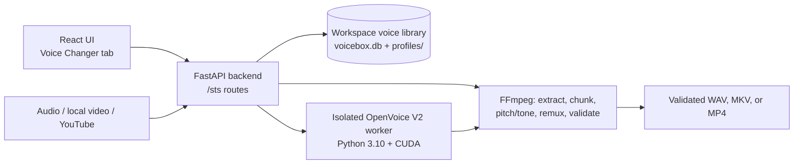

# VoiceBridge Studio

A fully local voice studio for Windows: clone voices, generate speech, and
convert existing recordings and videos into any of your voices, all on your own
machine with no cloud inference, subscription, or per-minute cost.

VoiceBridge Studio is built on [VoiceBox](https://github.com/jamiepine/voicebox)
by Jamie Pine and contributors (MIT). It keeps VoiceBox's text-to-speech,
voice cloning, stories, captures, effects, and model management, and adds
**speech-to-speech** as a built-in feature: the Voice Changer tab. See
[NOTICE.md](NOTICE.md) for credits and licenses.

> [!IMPORTANT]
> Use only voices and source media that you own or have permission to process.
> Every voice-changer job requires an explicit rights confirmation. This app
> does not bypass DRM, account restrictions, or access controls.

## Features

- **Text-to-speech and voice cloning** with VoiceBox's engines (Qwen3-TTS,
  Chatterbox, LuxTTS, TADA, Kokoro, OmniVoice), generation history, versions,
  effects, stories, and dictation captures.
- **Voice Changer (speech-to-speech)**: convert a speech recording, a video
  from your PC, or an authorized YouTube video into a cloned voice while
  keeping the source's timing, pacing, emphasis, and emotion. Powered by an
  isolated OpenVoice V2 runtime.
  - Uses the same voice profiles as TTS, read directly from the workspace:
    no second app, no API bridge, no reference copies.
  - Per-voice pitch correction (formant-preserving) and tone controls,
    remembered for each voice.
  - Long videos are converted in aligned, overlapping chunks with one model
    load, reconstructed to the exact source frame count, and remuxed without
    re-encoding the picture (MKV with lossless FLAC, or MP4 with AAC).
  - Every output is fully decoded before it is reported complete.
- **Local HTTP API** for both TTS and STS; see `/docs` while the app runs, and
  [docs/sts/api.md](docs/sts/api.md) for the voice-changer endpoints.

## How speech-to-speech fits in

VoiceBox profiles are reference recordings plus transcripts, not per-speaker
RVC models. The Voice Changer takes the selected profile's reference sample
straight from the workspace database, extracts a speaker embedding with
OpenVoice V2, and converts the original performance directly. It never
transcribes to text and re-synthesizes, which would lose timing and delivery.



| Path | Responsibility |
| --- | --- |
| `backend/` | FastAPI backend (from VoiceBox): TTS engines, profiles, history, MCP server |
| `backend/sts/` | Speech-to-speech: workspace voices, OpenVoice client and worker, conversion and video pipelines |
| `backend/routes/sts.py` | `/sts` HTTP endpoints |
| `app/` | Shared React frontend; the Voice Changer is `app/src/components/VoiceChangerTab/` |
| `web/`, `tauri/` | Browser build and desktop shell |
| `scripts/` | Build, icon, and data-import scripts |
| `docs/sts/` | Voice-changer API, engine install, audit, and validation records |

## Requirements

- Windows 10 or 11 (VoiceBox's code also supports macOS and Linux; the
  voice-changer path has been validated on Windows)
- Python 3.12, [Bun](https://bun.sh), and [just](https://github.com/casey/just)
- An NVIDIA GPU is recommended; CPU works, slowly
- FFmpeg and FFprobe on `PATH`, and Node.js 22+ (for YouTube downloads)
- For the desktop app only: [Rust](https://rustup.rs) and the
  [Tauri prerequisites](https://v2.tauri.app/start/prerequisites/)

## Setup

1. **Backend environment** (PyTorch and the TTS engines; a multi-gigabyte download):

   ```powershell
   just setup-python
   ```

2. **Voice changer engine** (isolated OpenVoice V2 runtime, about 2.5 GB with
   CUDA PyTorch): follow [docs/sts/engine-install.md](docs/sts/engine-install.md).

3. **Bring over an existing VoiceBox library** (optional). If you used the
   standalone VoiceBox app, copy its profiles, samples, history, and captures
   into this workspace. The source is only read, never changed:

   ```powershell
   backend\venv\Scripts\python scripts\import_voicebox_data.py --dry-run
   backend\venv\Scripts\python scripts\import_voicebox_data.py
   ```

TTS model weights are shared through the Hugging Face cache, so models already
downloaded by VoiceBox are reused rather than downloaded again.

## Run

Double-click [`start-app.bat`](start-app.bat). It builds the web UI on first
run, starts the backend on `http://127.0.0.1:17493` with this folder's `data\`
workspace, and opens your browser. Close the standalone VoiceBox app first; both
use port 17493. Set `APP_PORT` to use a different port.

For development with hot reload:

```powershell
just dev       # backend + desktop app
bun run dev:web  # browser frontend against a running backend
```

`just --list` shows every command.

## Development and tests

```powershell
backend\venv\Scripts\python -m pytest backend\tests\sts   # voice changer (no GPU or ML stack needed)
backend\venv\Scripts\python -m pytest backend\tests       # full backend suite (needs just setup-python)
bun run typecheck
bunx biome check app/src
```

## Configuration

| Variable | Purpose |
| --- | --- |
| `APP_PORT` | Launcher port (default 17493) |
| `STS_ENGINE_DEVICE` | `cuda:0` (default), `cuda`, `cuda:<index>`, or `cpu` |
| `STS_ENGINE_ROOT` | Folder holding `.envs/`, `third_party/`, and `data/models/` for the engine, if not the project root |
| `STS_VIDEO_JOB_RETENTION_DAYS` | Completed video job retention (default 30) |
| `STS_FAILED_VIDEO_JOB_RETENTION_HOURS` | Failed video job retention (default 24) |
| `VOICEBOX_MODELS_DIR` | Custom Hugging Face model cache for TTS models |

## Updates and releases

Auto-update is disabled: upstream VoiceBox's release feed and signing key were
disconnected. See [SECURITY.md](SECURITY.md) for how to wire up your own.

## Project records

- [AGENTS.md](AGENTS.md): architecture decisions, constraints, and project memory
- [docs/sts/engine-audit.md](docs/sts/engine-audit.md): engine selection and license audit
- [docs/sts/validation.md](docs/sts/validation.md): privacy-safe validation results
- [CHANGELOG.md](CHANGELOG.md): upstream VoiceBox history up to the import

## Credits

- [Jamie Pine and the VoiceBox contributors](https://github.com/jamiepine/voicebox): the app this is built on
- [MyShell AI / OpenVoice](https://github.com/myshell-ai/OpenVoice): voice conversion
- [yt-dlp](https://github.com/yt-dlp/yt-dlp) and [FFmpeg](https://ffmpeg.org/)

## License

VoiceBox-derived code is MIT licensed, © Voicebox Contributors; see
[LICENSE](LICENSE) and [NOTICE.md](NOTICE.md).
